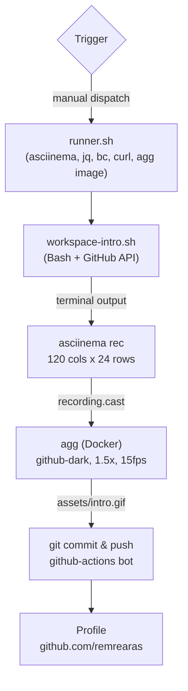

# remrearas Profile (.github) Repository

Profile and shared configurations for [remrearas](https://github.com/remrearas).

## Overview

This repository contains:

- **Profile** — Neofetch-style terminal animation displayed on the profile page
- **Workflows** — GitHub Actions for automated content generation

## Pipeline



## Structure

```
.github/
├── profile/
│   └── README.md                ← Profile
├── assets/
│   └── intro.gif                ← Terminal animation (auto-generated)
├── scripts/
│   └── workspace-intro.sh       ← Animation script
└── .github/
    ├── main/
    │   └── scripts/
    │       └── runner.sh        ← Workflow dependency setup
    └── workflows/
        └── generate-intro.yml   ← Animation workflow
```

## Animation

The script simulates running `neofetch` in a terminal and prints two columns side by side:

| Column | Content                                                              |
|--------|----------------------------------------------------------------------|
| Left   | Arch Linux ASCII art (derived from neofetch)                         |
| Right  | Name, location, company, website, member since, pinned repositories, color palette |

Profile data is fetched from the GitHub REST API and pinned repositories (up to 6) from the GraphQL API using `gh`. In the workflow, `gh` is authenticated with `GH_TOKEN`.

## Configuration

Editable constants in [`scripts/workspace-intro.sh`](scripts/workspace-intro.sh):

```bash
# GitHub
GITHUB_USER="remrearas"

# ASCII art left-column width (visible chars, padded with spaces)
ART_WIDTH=42

# Animation Timing
LINE_DELAY=0.06            # Delay between output lines (seconds)
TYPING_SPEED=0.04          # Base typing speed (seconds)
TYPING_VARIANCE=0.02       # Random variance per keystroke
COMMAND_PAUSE=0.3          # Pause after typing a command
END_PAUSE=3                # Final prompt duration (seconds)
```

## Workflow

The `generate-intro.yml` workflow runs on a GitHub-hosted runner (`ubuntu-latest`). It installs dependencies via [`runner.sh`](.github/main/scripts/runner.sh), records the terminal animation using [asciinema](https://asciinema.org/) and converts it to GIF using [agg](https://github.com/asciinema/agg).

**Trigger:** Manual dispatch

**Theme:** `github-dark` (set via `AGG_THEME` in the workflow)

**Output:** `assets/intro.gif`

The recording is 120 × 24. The output uses 23 rows; since pinned repositories are limited to 6, it always fits without scrolling.

## License

This project is licensed under the MIT License — see the [LICENSE](LICENSE) file for details.

Third-party software licenses are documented in [THIRD_PARTY_LICENSES](THIRD_PARTY_LICENSES).
